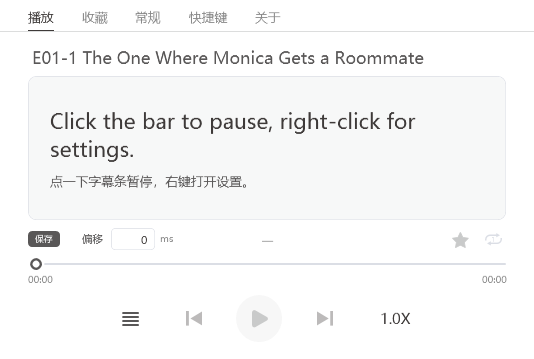
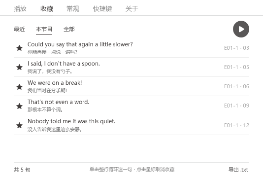
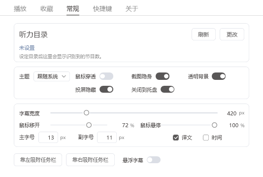
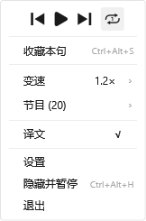
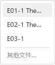
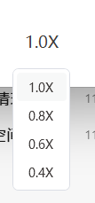

# LoafEar · 任务栏字幕条

[](https://dotnet.microsoft.com/)
[](https://www.microsoft.com/windows)
[](LICENSE)

**把本地音频的字幕钉在 Windows 任务栏里，像桌面背景一样常驻，安静地练听力。**

LoafEar 是一个 Windows 桌面工具：它把当前播放音频的当前句字幕，做成一条**真正嵌进任务栏的子窗口**，
而不是一个悬浮窗。你可以一边浏览网页、一边敲代码，余光就能扫到字幕，用碎片时间磨耳朵。

- 🎧 只处理**本地音频 + 本地字幕**，不联网、不依赖任何播放器生态
- 📺 字幕条是 `Shell_TrayWnd` 的**真子窗口**，默认贴在任务栏右侧，可切到左侧，也能脱离任务栏当置顶浮窗（桌面歌词那种玩法）
- ⏯ 右键菜单、全局热键、老板键、单句循环、逐句收藏、变速不变调，全都能用
- 🍞 单文件程序，图标是一只面包（exe / 窗口 / 托盘共用同一份矢量渲染）

---

## 效果预览

| 播放页 | 悬浮字幕（桌面歌词模式） |
|---|---|
|  |  |

| 收藏页 | 常规设置 |
|---|---|
|  |  |

任务栏字幕条右键菜单（播放控制压成一行图标，变速 / 节目收进二级菜单）：



目录浮层 / 倍速下拉 / 调宽时的临时高亮态：

  

---

## 核心特性

### 听力目录：设一次就够了
指定一个目录，程序递归扫描（最多 3 层），自动把音频和字幕按文件名配对、自然排序（`E01 < E02 < E3 < E10`）。
换集走播放页右下角的「目录」浮层，或字幕条右键 →「节目」。

- 音频：`.mp3 .m4a .m4b .aac .wav .flac .wma .ogg .opus`
- 字幕：`.srt .ass .ssa .lrc .vtt`

### 字幕条：贴着任务栏，也能浮起来
- **吸附模式**：默认贴在任务栏右端，可在「常规」页一键切到左端
- **悬浮模式**：勾上「悬浮字幕」，字幕条变成置顶浮窗，可拖到屏幕任意位置；上锁后点字幕只控制播放、不会被误拖
- **鼠标穿透 / 截图隐身 / 透明背景 / 投屏隐藏**：一堆为「摸鱼」设计的开关
- 透明度分「停留 / 移开」两档，字幕条宽度、字号、偏移都能调

### 字幕渲染：40px 高度内的讲究
- 支持 SRT / LRC / VTT / ASS / SSA，UTF-8 或带 BOM 的 ANSI 都能读
- ASS 的卡拉 OK 逐字高亮（`\k`/`\kf`/`\K`）、主副色、内联改色、粗斜体、淡入淡出
- 长句**不截断、不滚动，而是按词分页**：每屏文字静止，读完再整体翻页；停留时间按音节数而非字数估算
- 时间轴以**音频播放位置为唯一时钟**，每 50ms 二分查找当前句，一集播完不累积漂移

### 学习功能
- **单句循环**：反复听同一句
- **变速不变调**：0.4× / 0.6× / 0.8× / 1.0×，基于 SoundTouch
- **逐句收藏**：收藏当前句、连播全部收藏、导出 txt
- **逐句改写**：主界面直接编辑当前句的字幕与译文并保存回文件

### 全局热键（都能在「快捷键」页改）

| 默认组合 | 作用 |
|---|---|
| `Ctrl+Alt+H` | 老板键：隐藏字幕条并暂停 / 再按显示并继续 |
| `Ctrl+Alt+Space` | 播放 / 暂停（也可以直接左键点字幕条） |
| `Ctrl+←` / `Ctrl+→` | 上一句 / 下一句 |
| `Ctrl+Alt+L` | 单句循环开 / 关 |
| `Ctrl+Alt+S` | 收藏当前句（再按取消） |
| `Ctrl+Alt+[` / `Ctrl+Alt+]` | 字幕偏移 −100ms / +100ms |

> 提示：`Ctrl+←` / `Ctrl+→` 是**全局热键**，会占用其它程序里「按词移动光标」的组合，可在设置里改成别的。

完整功能与操作说明见 **[详细文档](docs/详细文档.md)**。

---

## 快速开始

### 方式一：自己构建（需要 .NET 9 SDK）

```bash
git clone <你的仓库地址>
cd LoafEar
dotnet publish -c Release -r win-x64 --self-contained false -p:PublishSingleFile=true -o publish
```

生成的 `publish/LoafEar.exe` 双击即用。依赖 [.NET 9 桌面运行时](https://dotnet.microsoft.com/download/dotnet/9.0)。

### 方式二：直接用发布版
到 [Releases](../../releases) 下载最新 `LoafEar-*.exe`（约 1.1 MB，需 .NET 9 桌面运行时）。

### 第一次运行
1. 双击 exe —— 启动即显示主界面，字幕条贴到任务栏；没设目录时会显示一组测试字幕
2. 切到「常规」页 → 点「选择目录」，选一个听力目录
3. 目录里的音频和字幕自动识别、自动配对、自动开播
4. 关掉窗口收进托盘继续跑，双击托盘图标回来

---

## 技术要点

- **任务栏定位**：`FindWindow("Shell_TrayWnd")` 找到任务栏，`SetParent` 把字幕条挂成它的子窗口；explorer 重启或分辨率变化后由守护定时器校正
- **启动顺序**：扫描目录、开声卡、建托盘（WinForms `ContextMenuStrip` 首次建要 ~550ms）这些慢活全部排在「字幕条可见」之前，避免冷启动时右键让整个任务栏卡住
- **原生消息**：字幕条带 `WS_EX_NOACTIVATE`，拖动与锁按钮点击走原生 `WM_LBUTTONDOWN/UP + SetCapture`，不走 WPF 鼠标事件
- **播放输出**：默认 WinMM `WaveOutEvent`，因为实测 `WasapiOut` 在某些设备上会「状态显示 Playing 但进度不动」
- **单文件发布**：矢量图标用 Path 画，不依赖图片文件

详见[详细文档 · 技术要点](docs/详细文档.md#14-技术要点)。

---

## 已知限制

- 只贴主任务栏，不支持副屏 / 竖向任务栏
- 字幕条高度固定 40 DIP（任务栏本身只有 48 DIP）
- 变速有约 120ms 启动延迟（SoundTouch 块处理）
- 截图隐身依赖显卡驱动，个别机器会变成黑块
- 不能以管理员身份运行（`SetParent` 跨进程要求完整性级别一致）；检测到管理员权限时自动降级成悬浮窗
- 节目菜单最多列 30 个

---

## 项目结构

```
LoafEar/
├── Brand/            品牌图形与 brand.ico
├── Config/           配置、热键定义与主题
├── Diag/             卡顿记录器
├── Interop/          Win32 互操作（任务栏定位、窗口样式、热键）
├── Media/            NAudio 播放 + SoundTouch 变速 + 目录扫描
├── Overlay/          任务栏字幕条（真子窗口）
├── Subs/             SRT/LRC/VTT/ASS 解析、单句循环、收藏
├── Tray/             托盘图标（独立线程）
├── UI/               右键快捷菜单 + 矢量图标
├── docs/             详细文档与截图
└── MainWindow.xaml   主界面
```

## 许可证

[MIT](LICENSE) © 2026 LoafEar contributors
